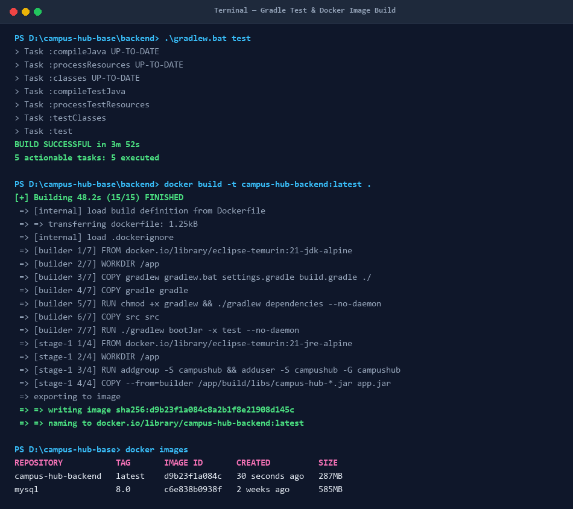
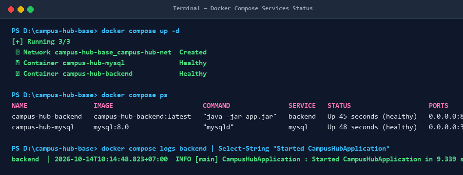
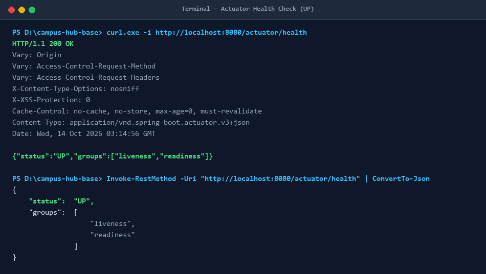

# BÀI KIỂM TRA ĐẦU GIỜ — ĐÓNG GÓI VÀ CHẠY CAMPUS HUB VỚI DOCKER

## Thông tin sinh viên
- **Họ và tên:** Doãn Mạnh Duy
- **Lớp / Mã SV:** HN_KS24_CNTT4
- **Môn học:** DevOps (IT209)
- **Repository:** [HN_KS24_CNTT4_DoanManhDuy_IT209_SS12_KIEMTRA](https://github.com/Duy18ND/HN_KS24_CNTT4_DoanManhDuy_IT209_SS12_KIEMTRA.git)

---

## 1. Lệnh dùng để chạy hệ thống

### Bước 1: Kiểm thử Backend với Gradle
```powershell
# Di chuyển vào thư mục backend và chạy test
cd backend
./gradlew test
# Trên Windows PowerShell / Command Prompt:
.\gradlew.bat test
```

### Bước 2: Build Docker Image cho Backend
```powershell
# Build Docker image từ thư mục backend
docker build -t campus-hub-backend .
# Hoặc từ thư mục gốc
docker build -t campus-hub-backend -f backend/Dockerfile ./backend
```

### Bước 3: Khởi chạy hệ thống bằng Docker Compose
```powershell
# Kiểm tra cấu hình compose hợp lệ
docker compose config

# Khởi động đồng thời Backend và MySQL
docker compose up -d

# Xem trạng thái các containers
docker compose ps
```

---

## 2. Cổng và URL kiểm tra Backend
- **Cổng công khai của backend:** `8080`
- **Cổng công khai của MySQL:** `3306`
- **URL kiểm tra sức khỏe (Health Check):**
  ```text
  http://localhost:8080/actuator/health
  ```
- **Lệnh kiểm tra:**
  ```powershell
  curl http://localhost:8080/actuator/health
  # hoặc trên PowerShell:
  Invoke-RestMethod -Uri "http://localhost:8080/actuator/health" | ConvertTo-Json
  ```
- **Kết quả kỳ vọng:** HTTP `200 OK`, JSON: `{"status":"UP","groups":["liveness","readiness"]}`

---

## 3. Ảnh chụp minh chứng kết quả làm bài

### Minh chứng 1: Gradle Test & Docker Image đã build thành công
Gradle test thực hiện kiểm thử tự động thành công (`BUILD SUCCESSFUL`), Dockerfile multi-stage build image `campus-hub-backend:latest` và xuất hiện trong danh sách `docker images`.



---

### Minh chứng 2: Trạng thái các Service sau khi chạy Docker Compose
Cả hai service `campus-hub-backend` và `campus-hub-mysql` đều khởi động, kết nối với nhau qua mạng nội bộ `campus-hub-net`, nhận đúng biến môi trường kết nối database và duy trì trạng thái hoạt động `Up (healthy)`.



---

### Minh chứng 3: Kết quả gọi endpoint `/actuator/health`
Endpoint `/actuator/health` trả về mã trạng thái HTTP `200 OK` cùng nội dung JSON thể hiện trạng thái `UP`.



---

## 4. Kiến trúc và Cấu hình hệ thống

### Dockerfile (`backend/Dockerfile`)
Sử dụng mô hình **Multi-stage build**:
1. **Stage 1 (Builder):** Sử dụng `eclipse-temurin:21-jdk-alpine`, copy cấu hình Gradle, cache dependencies và thực thi `./gradlew bootJar -x test --no-daemon` để tạo file JAR.
2. **Stage 2 (Runtime):** Sử dụng `eclipse-temurin:21-jre-alpine` tối ưu dung lượng, tạo user không đặc quyền `campushub` để đảm bảo bảo mật, cấu hình cổng `8080`, biến môi trường kết nối và cơ chế `HEALTHCHECK`.

### Docker Compose (`docker-compose.yml` / `compose.yml`)
- **Service `mysql`:** Sử dụng image `mysql:8.0`, thiết lập volume `mysql_data` để lưu trữ dữ liệu bền vững, healthcheck định kỳ bằng lệnh `mysqladmin ping`.
- **Service `backend`:** Tự động build từ `./backend/Dockerfile`, ánh xạ cổng `8080:8080`, nhận thông tin kết nối qua biến môi trường `DB_URL` sử dụng hostname service `mysql` thay cho `localhost`:
  ```yaml
  DB_URL: jdbc:mysql://mysql:3306/campus_hub?createDatabaseIfNotExist=true&useUnicode=true&characterEncoding=UTF-8&allowPublicKeyRetrieval=true&useSSL=false
  DB_USERNAME: root
  DB_PASSWORD: rootpassword
  ```
- `depends_on` với điều kiện `service_healthy` đảm bảo MySQL sẵn sàng đón nhận kết nối trước khi Backend khởi động.

---

## 5. Giới thiệu dự án gốc (Campus Hub Base)

Campus Hub là dự án nền cho Mini Project Session 13. Ứng dụng cung cấp một không gian chung để sinh viên đăng sự kiện, tìm đồ thất lạc, hỏi đáp, trao đổi đồ dùng và tìm nhóm.

### Tài khoản mẫu:
| Vai trò | Tên đăng nhập | Mật khẩu |
|---|---|---|
| Sinh viên | `student` | `student123` |
| Quản trị viên | `admin` | `admin123` |

### API chính:
| Phương thức | Đường dẫn | Mục đích | Xác thực |
|---|---|---|---|
| `POST` | `/api/auth/register` | Tạo tài khoản | Không |
| `GET` | `/api/auth/me` | Lấy người dùng hiện tại | Có |
| `GET` | `/api/categories` | Danh sách chuyên mục | Không |
| `GET` | `/api/posts` | Tìm và lọc bài đăng | Không |
| `GET` | `/api/posts/{id}` | Chi tiết bài đăng | Không |
| `POST` | `/api/posts` | Tạo bài đăng | Có |
| `PUT` | `/api/posts/{id}` | Sửa bài của mình | Có |
| `PATCH` | `/api/posts/{id}/status` | Đổi trạng thái | Có |
| `DELETE` | `/api/posts/{id}` | Xóa bài của mình | Có |
| `POST` | `/api/posts/{id}/comments` | Thêm bình luận | Có |
| `POST` | `/api/posts/{id}/reaction` | Bật hoặc tắt quan tâm | Có |
